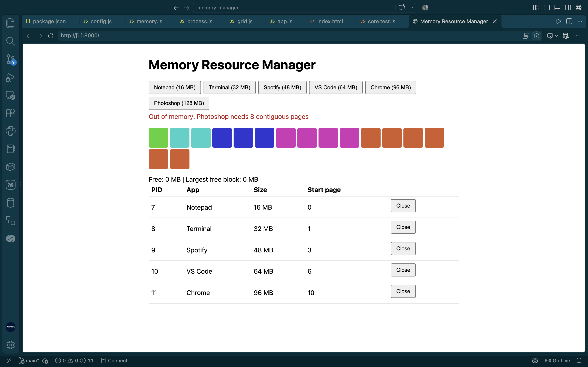
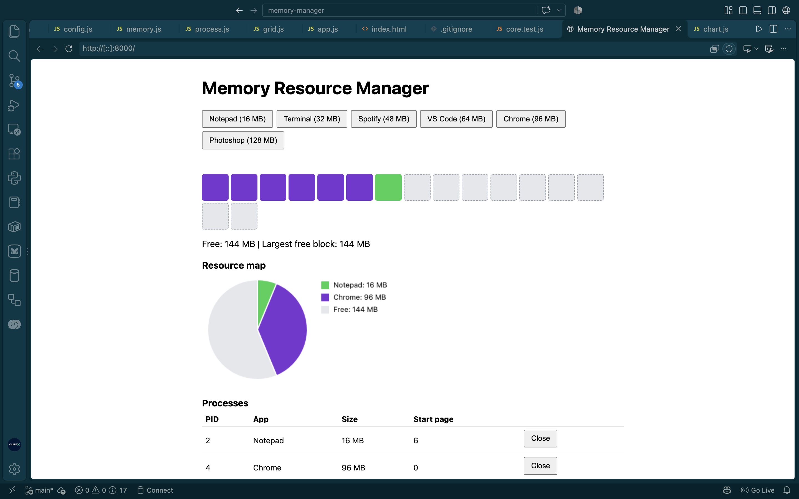
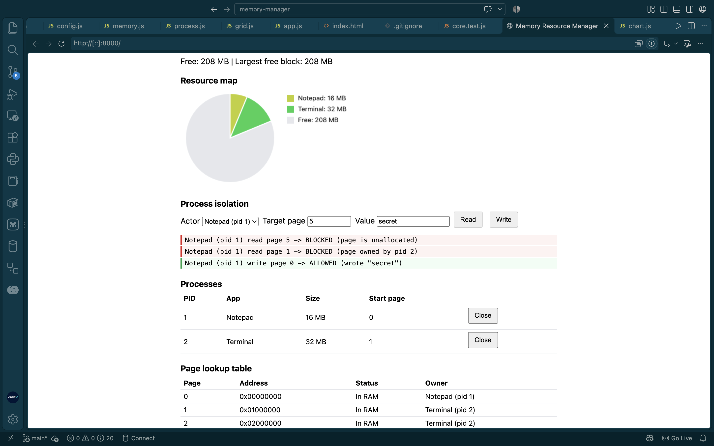
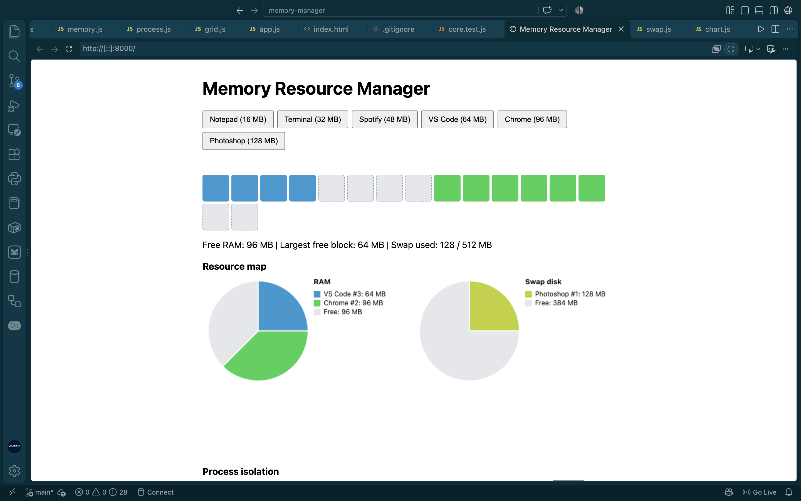
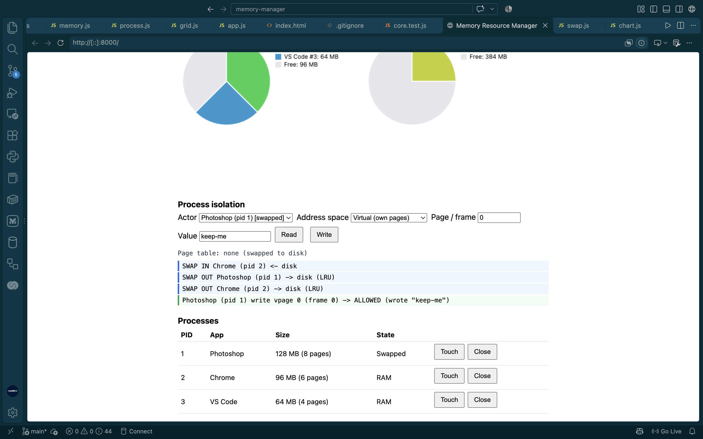

# Memory Resource Manager: User Manual

**Live demo:** https://aurex-ke.github.io/memory-manager/

A simulated memory manager. **Nothing real is touched.** It models **256 MB of RAM** (16 frames of 16 MB) and a **512 MB swap disk**.

## 1. Launch and close apps (allocation)

Click an app button (Notepad 16 MB, Terminal 32 MB, Spotify 48 MB, VS Code 64 MB, Chrome 96 MB, Photoshop 128 MB), or use **Custom app** to pick your own name and size.

- **Launch** gives the app free frames, **lowest number first**. Frames need not be next to each other.
- **Close** (in the Processes table) frees the frames so other apps can use them.
- Each app has its own colour in the grid. Grey dashed squares are **free**.
- Hover a square to see its frame, owner, and virtual page.

## 2. Read the resource map

- **Pie charts:** one for RAM, one for the swap disk.
- **Stats line:** free RAM, largest free block, swap used.
- **Frame lookup table:** every frame with its address, status, owner, and virtual page.
- **Swap space table:** which processes currently live on disk.

## 3. Test process isolation

Launch **Photoshop**, then **Notepad**. Photoshop owns frames 0-7.

| Test | Actor | Address space | Page / frame | Result |
|---|---|---|---|---|
| **Rogue access** | Notepad | Physical | `0` | **BLOCKED** (page owned by pid 1) |
| **Segfault** | Notepad | Virtual | `5` | **BLOCKED** (virtual page out of range) |
| **Legal access** | Notepad | Virtual | `0` | **ALLOWED** |

Pick **Read** or **Write**. Every attempt appears in the **log**: green = allowed, red = blocked.

**Wipe-on-free:** when an app closes, its frames are erased, so the next owner never sees old data.

## 4. Watch virtual memory (swapping)

1. Launch **Photoshop** (128 MB), then **Chrome** (96 MB). RAM is almost full.
2. Launch **VS Code** (64 MB). It does not fit.
3. The **least-recently-used** app (Photoshop) is **swapped out** to disk. A blue log line confirms it.
4. Click **Touch** on Photoshop. It swaps back **in**, and something else may swap out.

Swapped apps show **Swapped** in the Processes table and `Page table: none (swapped to disk)`. When an app returns, it may land on **different frames**. Its data and virtual pages stay the same.

## 5. Auto-activity

**Auto-activity: ON** touches one random app per second. With 3+ big apps running, you will see **thrashing**: apps constantly swapping in and out. Click again to stop.

## 6. Reset and limits

- **Reset** stops auto-activity and clears all processes, RAM, and swap.
- **Whole-process swapping:** an app is swapped entirely, not page by page.
- **LRU only:** the oldest-used app is always the victim.
- **Out of memory:** if RAM and swap are both full, the launch is refused with an error.
